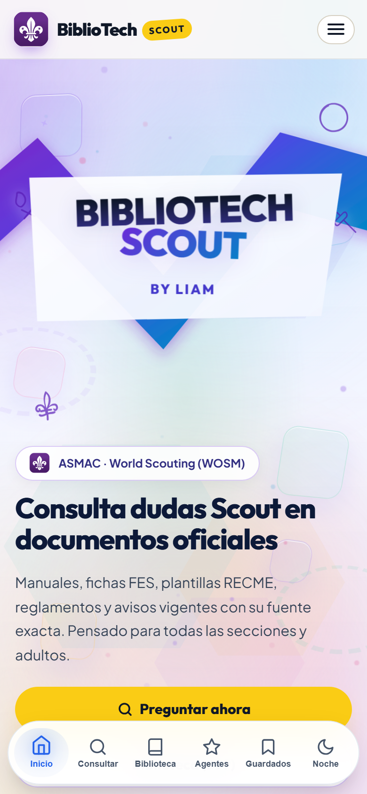
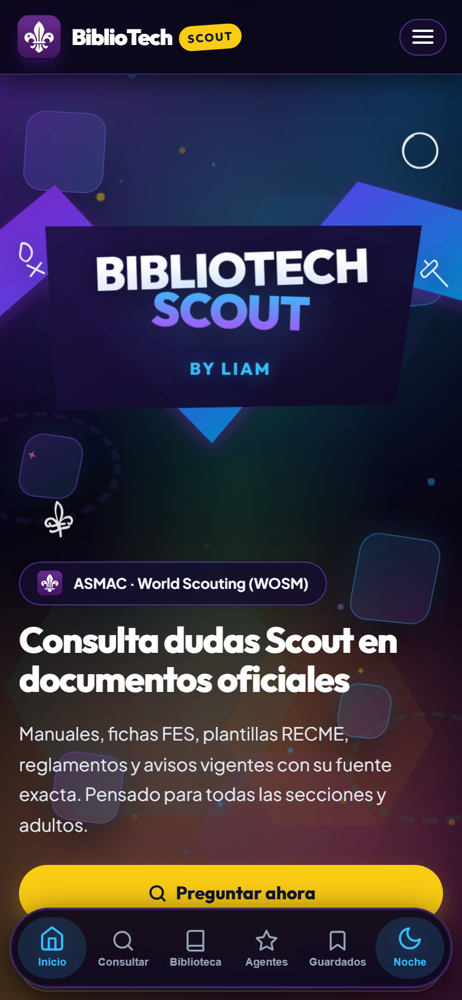
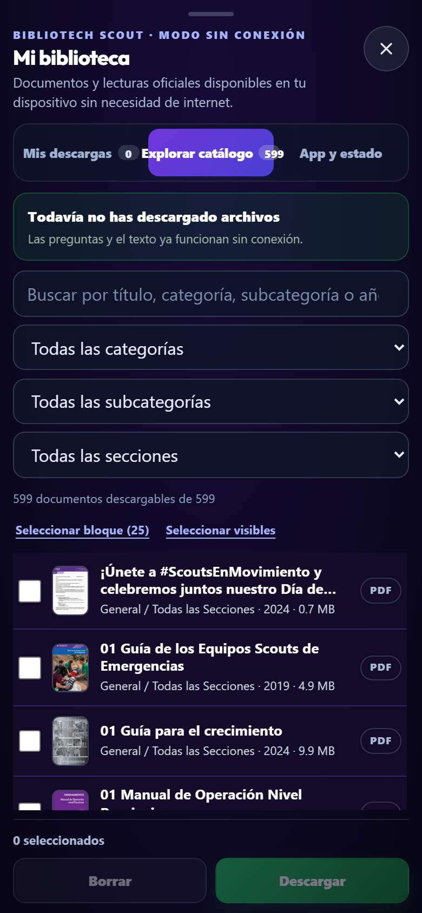
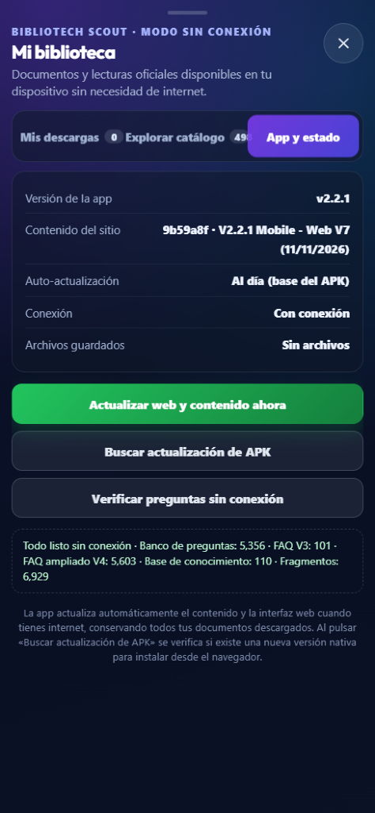
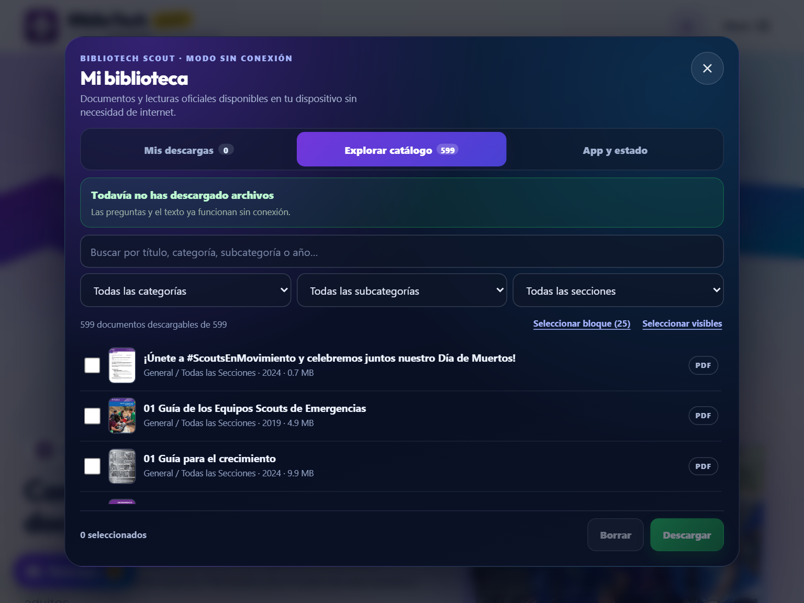

# BiblioTech Scout — App Oficial para Android (APK)

Aplicación oficial para **teléfonos y tablets Android** de **BiblioTech Scout**, diseñada para consultar manuales, reglamentos, progresiones, trámites y documentos oficiales del escultismo (ASMAC y World Scouting WOSM) incluso en campamentos y actividades sin acceso a internet.

- **Versión actual:** `4.3.0` (`versionCode 53`) — `4.3.0 Mobile - Web 10.3.0 (26/11/2026)`
- **Creador:** Liam Durán · Comunidad de Caminantes · Provincia Tláhuac-Xochimilco · **Contacto:** `rdc.tlxh@gmail.com`
- **Descarga oficial del APK:** [GitHub Releases (`bibliotech-scouts-app`)](https://github.com/ey-liam/bibliotech-scouts-app/releases/latest)

---

## 1. Convención de Versionado de 3 Dígitos (`MAJOR.MINOR.PATCH`)

Tanto el sitio web (`9.8.0`) como la aplicación Android (`3.8.0`) usan numeración semántica de tres dígitos:

- **Primer dígito (`X.0.0`):** Cambio mayor de arquitectura, plataforma o rediseño completo.
- **Segundo dígito (`X.Y.0`):** Nuevas funciones relevantes dentro de la app, integraciones nativas o ampliaciones importantes del catálogo/preguntas.
- **Tercer dígito (`X.Y.Z`):** Ajustes visuales, correcciones de errores, parches de estabilidad o actualizaciones menores de interfaz.

---

## 2. Comparación: Modo Claro vs Modo Oscuro en Android

La app adapta automáticamente sus superficies, tarjetas, tipografía y lector PDF al cambiar entre **Modo Claro** y **Modo Oscuro** desde el dock inferior (`Noche`) o la barra superior en tablets.

| Teléfono Android — Modo Claro | Teléfono Android — Modo Oscuro |
| :---: | :---: |
|  |  |

---

## 3. Vistas y Apartados Dentro de la App (Teléfono y Tablet)

| Apartado / Pantalla | Qué es y qué puedes hacer ahí | Captura |
| :--- | :--- | :---: |
| **Consultas Offline (`Buscador`)** | Pregunta cualquier duda scout o filtra por sección (*Manada*, *Tropa*, *Comunidad*, *Clan*, etc.) sobre las `21,293` preguntas y respuestas empaquetadas sin depender de datos móviles, con lectura en voz alta, nomenclatura oficial y citas documentales cruzadas. |  |
| **Mi Biblioteca — Explorar Catálogo** | Abre el gestor nativo desde el menú móvil o el botón flotante para buscar entre los `883` documentos oficiales, filtrar por categoría/subcategoría/sección y descargar archivos individuales o en bloques de `25` para llevarlos sin conexión. |  |
| **App y Estado (`OTA y Diagnóstico`)** | Verifica la versión instalada del APK, el commit web sincronizado, conectividad, cantidad de documentos guardados, actualización en segundo plano (`Actualizar web y contenido ahora`), revisión de APK nuevo y diagnóstico del banco offline. |  |
| **Vista Adaptada para Tablet Android** | Aprovecha pantallas medianas y grandes con diseño de catálogo amplio, barra superior completa y panel gestor lateral/modal cómodo para consulta grupal o de dirigentes. |  |

*(Dentro del contenido de la app dispones de todos los espacios dedicados: **Inicio**, **Guía**, **Biblioteca**, **Ejes Temáticos**, **Skills**, **Agentes de Cambio**, **La Fogata**, **Editor de archivos** y **Acerca de**).*

---

## 4. Funciones Exclusivas de la App Android (Modo Offline APK)

A diferencia de consultar la página web cuando requiere red constante, la **App Android (APK)** integra capacidades nativas específicas:

1. **Banco de `21,293` preguntas 100% sin conexión (`data/` empaquetado):** El buscador completo (`5,365` base, `101` `faq_v3`, `15,828` `faq_v4`, `105` temas de base de conocimiento y fragmentos de lectura) y las `883` portadas JPG oficiales viven dentro del APK desde el primer arranque.
2. **Descarga local persistente de hasta `883` documentos oficiales (`Mi biblioteca`):** Permite bajar PDFs, hojas Excel y documentos oficiales en almacenamiento interno mediante `@capacitor/filesystem`, seleccionando archivos uno por uno o en bloques de `25`.
3. **Lector PDF nativo integrado (`PdfViewerPlugin.java`) + Visor streaming HD en línea:** Renderiza páginas descargadas sin conexión con Android `PdfRenderer` (protegido contra desbordamiento de memoria en páginas gigantes), y para archivos pesados en línea (`50–300+ MB`) antes de descargarlos ofrece vista previa inmediata página por página mediante streaming HTTP 206.
4. **Visor de hojas de cálculo Excel offline y exportación CSV:** Filtra tablas y exporta vistas directamente desde el almacenamiento interno de la app.
5. **Actualizaciones OTA atómicas de interfaz y contenido (`OtaUpdaterPlugin.java`):** Sincroniza en segundo plano mejoras del sitio web y nuevos archivos JSON sin perder tus PDFs ya descargados ni tus documentos marcados en **Guardados**.
6. **Guardados e historial local persistente:** Conserva documentos favoritos, historial de consultas recientes y notas locales entre sesiones.

---

## 5. Instalación Segura y Aviso de Google Play Protect

1. Descarga el archivo `bibliotech-scout.apk` (de la versión `v2.3.4` o la más reciente) únicamente desde la sección **Releases** de este repositorio. Puedes comprobar su integridad verificando el archivo `bibliotech-scout.apk.sha256` incluido en el mismo Release (`sha256sum -c bibliotech-scout.apk.sha256` o `Get-FileHash bibliotech-scout.apk`).
2. En **Ajustes** de Android, habilita temporalmente *Instalar aplicaciones desconocidas* para tu navegador o gestor de archivos.
3. **Aplicación segura y de código abierto:** Debido a que el APK se distribuye de forma directa y gratuita sin pasar por Google Play Store, Android puede mostrar inicialmente la ventana de revisión de **Google Play Protect**. Al pulsar **Analizar app**, Play Protect habitualmente verifica el paquete sin detectar riesgos ni mostrar alerta de inseguridad; si en algún dispositivo solicita confirmación adicional, selecciona *Más detalles → Instalar de todos modos*.
4. La aplicación **no** solicita permisos invasivos ni `REQUEST_INSTALL_PACKAGES` para instalar paquetes externos; solo usa almacenamiento interno privado para tus documentos descargados y acceso de red para descargas/actualizaciones.

---

## 6. Herramientas y Tecnologías Utilizadas

- **Contenedor Híbrido y Plugins:** **Capacitor 8** (`@capacitor/core`, `@capacitor/android`, `@capacitor/app`, `@capacitor/filesystem`, `@capacitor/network`, `@capacitor/preferences`, `@capacitor/dialog`, `@capacitor/toast`, `@capacitor/browser`, `@capacitor-community/file-opener`).
- **Capa Nativa Android (`android/`):** **Java** + **Android SDK** (`MainActivity.java`, `PdfViewerPlugin.java` basado en `PdfRenderer`, `OtaUpdaterPlugin.java` con descarga atómica HTTP y cache de activos) y **Gradle**.
- **Interfaz y Overlay Móvil (`web-overlay/`):** `HTML5`, `CSS3`, `JavaScript (ES6+)` (`native-bridge.js`, sincronizado con la base de datos y estilos del sitio oficial `bibliotech-scouts`).
- **Automatización y Compilación:** **Node.js** (`scripts/sync-web.mjs` con minificación `esbuild` en el overlay) y **GitHub Actions** (`.github/workflows/android.yml`) para validar código, activar optimización **R8 / ProGuard** en release, firmar el APK, publicar su huella `SHA-256` (`bibliotech-scout.apk.sha256`) y generar el Release al etiquetar una nueva versión (`vX.Y.Z`).

---

## 7. Novedades de la Versión `3.8.0` (Web `9.8.0`)
- **Visor PDF por página con streaming HTTP 206 para archivos pesados (`50–300+ MB`) y protección de memoria en `PdfViewerPlugin.java`:** permite previsualizar al instante manuales pesados antes de descargarlos y protege dispositivos de gama baja contra errores de memoria en páginas de gran altura.
- **Banco ampliado a `21,134` preguntas verificadas (+42.5%) sobre los `883` documentos oficiales:** incluye `664` documentos con nomenclatura oficial visible, enlaces cruzados entre archivos relacionados (`related_doc_ids`) y preguntas sugeridas con recarga aleatoria dentro del lector.
- **Rediseño visual editorial y motor de rendimiento `data-bt-perf="lite"` para dispositivos de baja gama:** interfaz más uniforme, rápida y limpia sin animaciones infinitas ni pérdida de calidad en las imágenes.
- **Editor de Archivos y paquete APK depurado:** 6 formatos oficiales editables offline y limpieza de activos no referenciados en `sync-web.mjs`.

### Base anterior (`3.2.0` / Web `9.2.0`)
- **Optimización móvil y arranque paralelo:** carga en paralelo en el inicio de Android, timeouts de red con `AbortController`, reducción de partículas 3D en segundo plano y render diferido en WebView.
- **Cero botones encimados en móvil:** botón flotante `Descargas` elevado limpiamente por encima del dock inferior (izquierda) y oculto automáticamente al abrir modales o visores; `↑` a la derecha encima del dock; banner offline reposicionado sin solapamiento.
- **Navegación nativa y sin duplicados:** botón físico/gesto Atrás de Android cierra modales web y regresa primero a Inicio antes de salir; dentro del APK se ocultan invitaciones redundantes a descargar el APK y el enlace `App / Modo Offline` abre directo el gestor de descargas sin conexión.

### Base anterior (`3.1.0` / Web `9.1.0`)

- **Arquitectura por 5 Espacios Dedicados:** *Inicio y Buscador*, *Biblioteca y Catálogo unificados*, *Guía Scout con sub-pestañas*, *La Fogata* y *Formatos*, con dock inferior móvil de 5 botones claros (*Inicio*, *Biblioteca*, *Fogata*, *Formatos*, *Guardados*).
- **Lector PDF Nativo Android mejorado (`#bt-pdf-viewer`):**
  - Salto directo **Ir a página `#`** al tocar el indicador de página.
  - Botones integrados de **Guardar** y **Notas locales** sincronizados con tus guardados y notas del sitio.
  - Botón **Reportar** directo desde el visor nativo.
  - **Modo lectura limpia (inmersivo):** toca el centro de la página para ocultar/mostrar las barras y leer a pantalla completa.
- **Lector Web compacto (`#docModal`):** cabecera de 1 fila con cajón `Info` plegable y barra de herramientas al pie en móvil.
